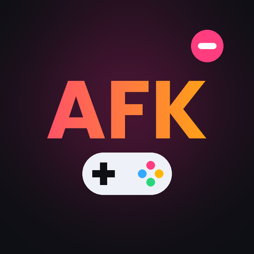

<p align="center">
  
</p>

<h1 align="center">AFK</h1>
<p align="center"><b>Tell your people you've gone dark.</b><br>
A tiny web app that lets your contacts know you're gaming, so they don't expect a reply.</p>

<p align="center"><i>by Samderverse</i></p>

---

## What it does

Pick the game you're about to play and who to tell. AFK opens WhatsApp, iMessage/SMS or your phone's share sheet with a ready-made message for each person:

> Hi Mum, Sam is now playing Grand Theft Auto VI 🎮 so don't expect any replies for a while.
>
> — Message generated by AFK

**AFK never sends anything itself.** It opens the chat with the text filled in, and you tap Send.

When you're done, tap **I'm back**. The session is logged and AFK offers to send a "back online" message, including how long you were gone.

## Features

- 🔎 **Game search.** Find any game by name, including upcoming releases, with cover art. No account or API key needed. If a game isn't found, you can add it exactly as you typed it.
- 📚 **Game library.** Every game you pick is saved for one-tap access, along with session count, total play time and when you last played.
- 👥 **Contacts.** Each contact has a name, a number and a preferred app (WhatsApp, iMessage/SMS or Share sheet).
- ✏️ **Custom wording.** Edit both messages using `{name}`, `{me}`, `{game}`, `{time}` (session length) and `{week}` (this week's total) tags.
- ⏱️ **Live session timer** and a history of recent sessions. Forgot to tap "I'm back"? It asks you to correct any session over 6 hours.
- 📊 **Game Time report.** Like iPhone Screen Time, but more incriminating: daily average, a week-by-day bar chart split by game, change from the week before, most-played games, longest session, latest night, biggest day, and a verdict from *"Touching grass. Suspicious."* to *"Legend status. Please blink."*
- 📸 **Share it.** Turn your report into an image card for Instagram stories, WhatsApp or the group chat, or share it as text.
- 💾 **Backup.** Export and import all your data as a JSON file.
- 🔒 **Private.** Everything is stored on your device (localStorage). There are no servers and no tracking.

## How the messaging works

| Send via | What happens |
|---|---|
| WhatsApp | Opens `wa.me/<number>?text=…`, which goes straight to that person's chat with the message typed in |
| iMessage / SMS | Opens the Messages app to that number with the message typed in |
| Share sheet | Opens your phone's share menu, so you can pick any app and any person |

UK numbers starting `07…` are converted to `+44` automatically. If a contact has no number, WhatsApp and Messages open with the text ready and you choose the recipient yourself.

> Web apps can't read your phone's address book on iPhone, so add each contact's number in AFK. On Android Chrome you can import contacts from your phone instead.

## Install on your phone

1. Open the GitHub Pages link in **Safari** (iPhone) or **Chrome** (Android).
2. **iPhone:** Share → **Add to Home Screen**. **Android:** ⋮ menu → **Add to Home screen** / **Install app**.
3. AFK opens full-screen with its own icon, like a normal app.

## Files

```
index.html             the whole app (HTML, CSS and JS in one file)
manifest.webmanifest   home-screen install settings
apple-touch-icon.png   iPhone home-screen icon (180×180)
icon-192.png           Android / favicon icon
icon-512.png           Android splash / install icon
```

## Credits

- Game search data from [Wikipedia](https://www.wikipedia.org/) via the MediaWiki REST API.
- Built by **Samderverse**.

Not affiliated with Rockstar Games, WhatsApp or Apple. GTA VI is just the reason it exists.
